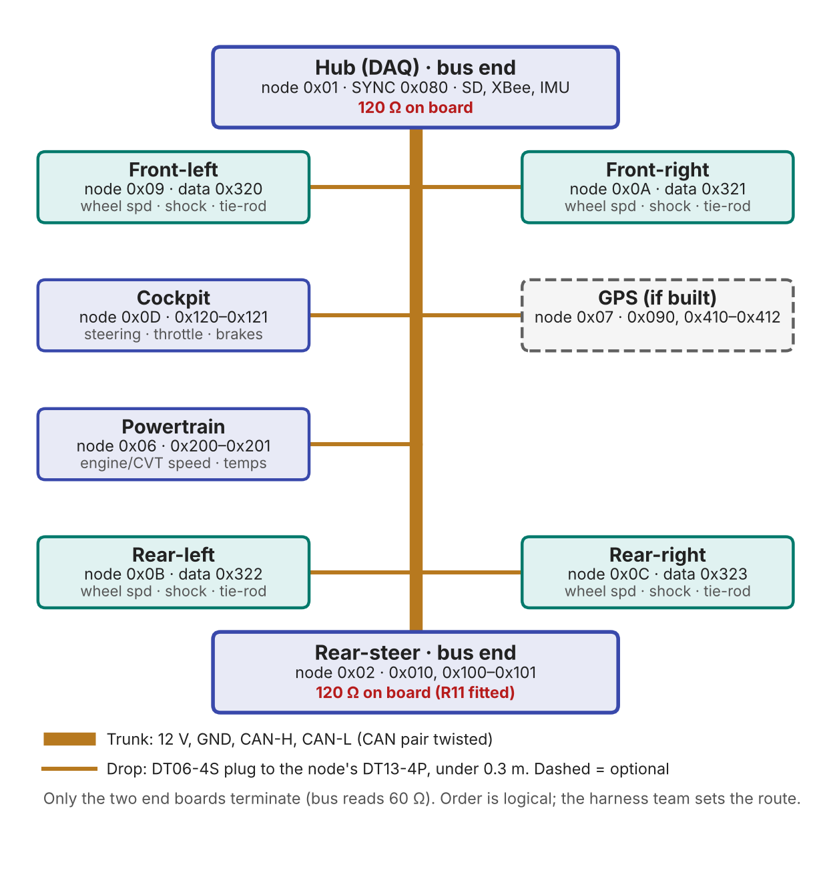

# Baja DAQ CAN spec v0.3

The single source of truth for the Bobcat Baja DAQ CAN bus: what every node sends, on which ID, in what format, and how a node board is built. If your board talks on the bus, it follows this repo.

> **v0 frozen Oct 19, 2026 (tag `spec-v0`).** Other teams build on these IDs and signals. Adding a message in your own slice: announce it at the Monday meeting. Changing or removing anything existing: agree at the meeting first, then bump `VERSION` in the DBC.
>
> **v0.2 (tag `spec-v0.2`)** follows the car topology approved at the Oct 19 meeting. See [What changed in v0.2](#what-changed-in-v02).
>
> **v0.3** retires the diff nodes: the diff boards are scrapped and the car moves to mechanical diff control. See [What changed in v0.3](#what-changed-in-v03).

## What's here

| Path | What | Kept by |
|---|---|---|
| `dbc/baja_daq.dbc` | Every message and signal: bytes, type, factor, offset, unit, cycle time. The machine-readable spec (`VERSION "0.3"`). | Toph |
| `docs/CAN_Node_Spec_v0.3.docx` | The human-readable spec: bus rules, car topology, node hardware, frame format, message table. | Toph |
| `docs/can_id_plan.md` | ID blocks, per-node slices, node IDs, how to add a node | Toph |
| `docs/altium-standard.md` | Club Altium standard: board defaults, title block, OutJob, parts library, schematic and PCB rules | Toph |
| `docs/topology_v0.3.png` | Car topology diagram: trunk, terminated ends, node drops | Toph |
| `docs/Standards_v0.3.pdf` | v0.3 standards: wire colors, DT 4 and 12 pin pinouts, bit rate, frame header and heartbeat, termination, power, MCU | Toph |
| `registry/can_id_registry.csv` | Who owns which node ID and ID slices | Wrigley |
| `tools/check_dbc.py` | DBC checker. Run before every DBC commit; must print `PASS`. | Toph |
| `tools/draw_topology.py` | Regenerates `topology_v0.3.png` (needs matplotlib) | Toph |
| `firmware/CAN_Node_Template/` | Arduino sketch to start a sensor node from: TWAI setup, byte packing helpers, a message table with send periods, bus-off recovery | Toph |

Older versions: `git checkout spec-v0` for the original frozen spec and the v0.1 docx; `git checkout spec-v0.2` for the v0.2 docx.

## What changed in v0.3

**Retired** (IDs not reused)
- Front diff: node `0x03`, `DiffF_Fault` `0x020`, `DiffF_Status` `0x210`, heartbeat `0x703`.
- Rear diff: node `0x08`, `DiffR_Fault` `0x021`, `DiffR_Status` `0x211`, heartbeat `0x708`.

The diff boards are scrapped; the car moves to mechanical diff control. Corners stay on `0x320–0x323`; nothing moves onto `0x210–0x213`.

**Unchanged:** every other ID and signal. Bus load falls from 18.9% to 17.7%.

## What changed in v0.2

**Added**
- Corner nodes `0x09–0x0C` on `0x320–0x323` (FL, FR, RL, RR): wheel speed, shock travel, tie-rod strain, 200 Hz.
- Cockpit node `0x0D` on `0x120` (steering wheel, throttle, brake switch, marker) and `0x121` (front/rear brake pressure).
- `PT_Temps` on `0x201` (CVT, head, gearbox temps, 10 Hz). Powertrain is now node `0x06`, assigned.

**Retired** (IDs not reused)
- SensorBoardV2: node `0x05`, `0x300` / `0x310`. Replaced by the corner nodes. Existing boards must also lose their 120 Ω (R8).
- Fuel gauge: node `0x04`, `0x500`. A sensor in the tank is not feasible.

**Termination moved** from the harness end plugs onto the **hub and rear-steer** boards, the two ends of the trunk.

**Unchanged:** every other ID and signal. Diff status stays on `0x210` / `0x211`. Bus load rises from 12.9% to 18.9%.

## Quick start

```sh
git clone https://github.com/Bobcat-BAJA/can-spec.git
cd can-spec
python -m pip install cantools

# Check the DBC (duplicate IDs, ID blocks, endianness, round-trip, bus load)
python tools/check_dbc.py dbc/baja_daq.dbc

# Decode a candump log into real units
cantools decode dbc/baja_daq.dbc < candump.log

# Browse every message and signal
cantools dump dbc/baja_daq.dbc

# Redraw the topology diagram
python -m pip install matplotlib
cd docs && python ../tools/draw_topology.py
```

On Windows, if `python` opens the Microsoft Store, turn off the `python.exe` alias under Settings › Apps › Advanced app settings › App execution aliases, or use `py`.

## The bus at a glance



| | |
|---|---|
| Protocol | Classic CAN 2.0A, 11-bit IDs, 1 Mbit/s. No CAN FD, no remote frames. |
| Transceiver | TI SN65HVD230DR on 3.3 V, RS to GND |
| Topology | One continuous trunk from the hub to rear-steer. Each node drops off it with a stub under 0.3 m; longer sensor cables (DTM) run from the node, not the bus. Harness team sets the physical route. |
| Termination | 120 Ω on the two trunk-end boards only: hub and rear-steer (R11 fitted). Bus measures 60 Ω. No terminator on any other node or in the harness. |
| Connector | One Deutsch DT13-4P per node (12 V, GND, CAN-H, CAN-L), mates with DT06-4S drop plugs |
| Timing | Hub sends `SYNC` on `0x080` every 50 ms; nodes timestamp data relative to it |
| Bus load | ~1,370 frames/s, 17.7% of 1 Mbit/s worst case. Limit is 50%. |

Keep CAN-H/CAN-L twisted and away from the ignition lead and rear-steer motor wires.

## Node hardware

| | |
|---|---|
| MCU | Seeed XIAO ESP32-C3 on every node. The hub is a XIAO ESP32-S3. |
| CAN pins | TX = **D7** (GPIO20), RX = **D10** (GPIO10) |
| Boot pins | **D0, D8, D9** are sampled at reset. Never pull them low at power-up. |
| Firmware | Arduino "USB CDC On Boot" = **Enabled**, or `Serial` takes D7. Use D-pin names, not GPIO numbers. |
| Board | Start from the club Altium project template and place the **CAN Node Core** reuse block. See `docs/altium-standard.md`. |

## Node firmware template

`firmware/CAN_Node_Template/CAN_Node_Template.ino` is the starting point for a sensor node on a XIAO ESP32-C3. Copy the whole folder for your node, then:

1. Write a fill function per message that packs your values with `addOneByte` / `addTwoBytes` / `addThreeBytes` / `addFourBytes` (little-endian, integers only) and returns the byte count.
2. Add one line per message to the `messages[]` table: `{ ID, period in ms, fill function, 0 }`, using only IDs from your node's slice in the registry.
3. Delete the example messages.

Before the node goes on the car, check it against this spec. The template as committed does not yet do all of it:

- **CAN pins:** the template uses GPIO5 / GPIO4. The spec is TX = D7 (GPIO20), RX = D10 (GPIO10).
- **Frame header:** data frames need the 3-byte header (sequence counter, time since SYNC), leaving 5 data bytes. The template packs data from byte 0.
- **Heartbeat:** must be on `0x700` + your node ID with the full heartbeat layout in Frame format below. The example sends uptime only on `0x700`.
- **Example IDs:** `0x100` is rear-steer's slice. Replace both examples before flashing.

## Frame format

**Data frames** carry a 3-byte header and up to 5 data bytes:

| Byte | Field | Type | Meaning |
|---|---|---|---|
| 0 | Sequence counter | u8 | +1 per message on this ID, wraps 255 → 0. A gap means a dropped frame. |
| 1–2 | Time since SYNC | u16 | µs since the node last saw SYNC. `0xFFFF` = no SYNC yet. |
| 3–7 | Data | — | Per message, see the DBC |

**Heartbeat** on `0x700 + node ID`, 1 Hz, every node, no header: node ID, state (0 booting, 1 OK, 2 warning, 3 fault), error flags (u16), firmware major/minor, uptime (s).

**Data rules:** integers only, little-endian, no floats. Real value = raw × factor + offset. Signed types for anything that can go negative. "Not available" is all ones (`0xFF`, `0xFFFF`, `0x7FFF` signed), never 0. Periodic messages on a steady schedule; faults on change, then 10 Hz while active.

## ID map

Lower ID wins arbitration, so faults sit lowest and slow data highest. Each node gets a 16-ID slice inside a block.

| IDs | Block | Slices |
|---|---|---|
| `0x000–0x07F` | Faults | rear-steer `0x010`, `0x020–0x02F` retired |
| `0x080–0x0FF` | Timing | SYNC `0x080`, GPS time `0x090` |
| `0x100–0x1FF` | Steering | rear-steer `0x100–0x10F`, cockpit `0x120–0x12F` |
| `0x200–0x2FF` | Powertrain | powertrain `0x200–0x20F`, `0x210–0x21F` retired |
| `0x300–0x3FF` | Suspension and wheels | `0x300–0x31F` retired, corners `0x320–0x323` |
| `0x400–0x4FF` | Vehicle dynamics | hub IMU (internal), GPS `0x410–0x41F` |
| `0x500–0x5FF` | Electrical | `0x500–0x50F` retired, hub battery (internal) |
| `0x600–0x6FF` | Spare | — |
| `0x700–0x77F` | Heartbeats | `0x700` + node ID |

`0x400`, `0x401` and `0x510` are hub-internal (marked `HubInternal = 1` in the DBC): logged under these IDs so logs decode, but never put on the wire. Nobody else may use them.

## Nodes

| Node ID | Node | DBC name | Built by | Status |
|---|---|---|---|---|
| `0x01` | Hub (trunk end, terminated) | `HUB` | DAQ | assigned |
| `0x02` | Rear-steer (trunk end, terminated) | `REARSTEER` | Toph | assigned |
| `0x03` | ~~Front diff~~ | — | — | retired, do not reuse |
| `0x04` | ~~Fuel gauge~~ | — | — | retired, do not reuse |
| `0x05` | ~~SensorBoardV2~~ | — | — | retired, do not reuse |
| `0x06` | Powertrain (speeds, temps) | `POWERTRAIN` | Unassigned | assigned |
| `0x07` | GPS | `GPS` | DAQ, if built | reserved |
| `0x08` | ~~Rear diff~~ | — | — | retired, do not reuse |
| `0x09` | Front-left corner | `CORNER_FL` | Shock team | assigned |
| `0x0A` | Front-right corner | `CORNER_FR` | Shock team | assigned |
| `0x0B` | Rear-left corner | `CORNER_RL` | Shock team | assigned |
| `0x0C` | Rear-right corner | `CORNER_RR` | Shock team | assigned |
| `0x0D` | Cockpit | `COCKPIT` | Unassigned | assigned |
| `0x0E–0x0F` | — | — | — | reserved |
| `0x10–0x7F` | New nodes | — | Claim in the registry | open |

Full slice and message ownership is in `registry/can_id_registry.csv`.

## Adding a node or message

1. **Claim** a node ID and ID slice in `registry/can_id_registry.csv` (ask Wrigley).
2. **Define** every signal in `dbc/baja_daq.dbc`: bytes, type, factor, offset, unit, cycle time.
3. **Check:** `python tools/check_dbc.py dbc/baja_daq.dbc` until it prints `PASS`.
4. **Review:** open a pull request; Toph reviews.
5. **Announce** additions at the Monday meeting.
6. **Build** the board from the club template and CAN Node Core block. No terminator unless it's a trunk end.
7. **Bench test:** plug in, see the heartbeat on the dashboard, check values decode in real units.

Changes to **existing** IDs or signals need agreement at the Monday meeting *before* the pull request, and a `VERSION` bump in the DBC.

## What the checker enforces

`tools/check_dbc.py` loads the DBC in strict mode (no overlapping signals, valid DLCs) and fails on:

- duplicate frame IDs, or extended (29-bit) IDs
- any ID outside the blocks above
- `HB_*` messages not on `0x701–0x77F`
- big-endian signals, or scaled signals with no unit
- signals that don't survive an encode/decode round trip
- periodic on-bus traffic over 50% of 1 Mbit/s

## Contacts

| Area | Who |
|---|---|
| Spec, DBC, ID plan, Altium library | Toph Jones |
| ID registry | Wrigley Beardmore |
| Changes to anything frozen | Monday meeting |
